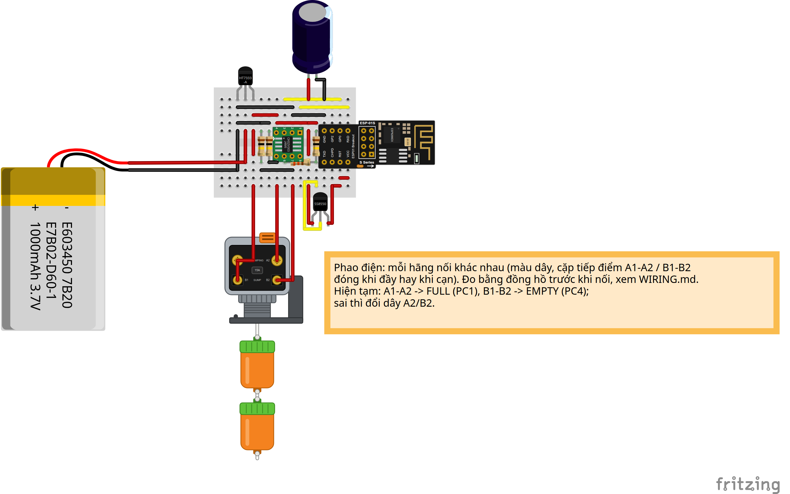
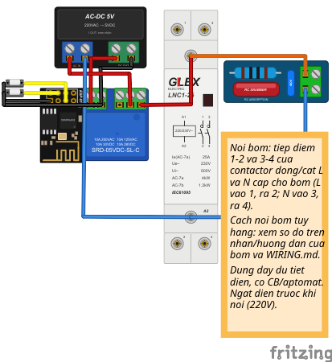

# Phao điện thông minh — firmware

Hệ thống báo mực nước cho bơm. **Mạch gửi** (ở phao) chạy pin: CH32V003J4M6 ngủ sâu, phao đổi trạng thái thì thức, cấp nguồn cho ESP-01S, ESP-01S gửi trạng thái qua ESP-NOW rồi cả mạch ngủ lại. **Mạch nhận** (ở tủ điện) dùng ESP-01 cắm trên module relay: nhận gói ESP-NOW, đóng cắt relay để điều khiển contactor của bơm, đồng thời báo lên **Blynk**.

## Tính năng

- Mạch gửi chạy pin LiPo, CH32V003 ngủ Standby, chỉ thức khi phao FULL hoặc EMPTY đóng (cạnh lên).
- Lọc dội tiếp điểm phao: trạng thái phải giữ ổn định 50ms mới chốt.
- CH32 chỉ cấp nguồn ESP-01S khi cần gửi (khóa PNP SS8550), ESP báo xong bằng chân ACK thì CH32 ngắt nguồn lại.
- Gửi ESP-NOW có thử lại, quét kênh Wi-Fi khi mất kết nối, nhớ MAC và kênh của mạch nhận trong EEPROM.
- Gói tin có mã khóa, kèm điện áp pin (đọc bằng ADC_VCC của ESP-01S, có bù offset).
- Mạch nhận: bơm bật khi bồn cạn, tắt khi bồn đầy; có nút nhấn bật/tắt bơm tay (GPIO2).
- Blynk: bật/tắt bơm từ điện thoại (V0), áp pin (V1), % pin (V2), nhật ký (V3).
- Cấu hình Wi-Fi bằng WiFiManager; có chế độ nạp OTA tạm khi không mang mạch nạp.

## Linh kiện

Danh sách đầy đủ, số lượng và link mua: [docs/BOM.md](docs/BOM.md)

## Nối dây

Mạch gửi (CH32V003J4M6 + ESP-01S + HT7333 + SS8550, trên breadboard mini):



Mạch nhận (module relay ESP-01S + ESP-01 + contactor):



Bảng nối chi tiết, bảng chân MCU, cách nối bơm vào contactor: **[docs/WIRING.md](docs/WIRING.md)**. File Fritzing nguồn: `docs/fritzing/sender.fzz`, `docs/fritzing/receiver.fzz`.

Phao điện mỗi hãng nối khác nhau. Đo thông mạch trước khi nối, xem ghi chú trong WIRING.md mục 3.

## Biên dịch & nạp

| Env | Dùng cho |
| :-- | :-- |
| `ch32v003_power_manager` (mặc định) | CH32V003J4M6 ở phao, nạp bằng WCH-LinkE (minichlink, chân SWIO) |
| `esp01s_sender_uart` / `esp01s_sender_passthrough` | ESP-01S mạch gửi, nạp qua mạch nạp USB / qua ESP32 cầu nạp |
| `esp01s_receiver_uart` | ESP-01 mạch nhận, nạp qua mạch nạp USB |
| `esp01s_receiver_passthrough` / `esp01s_receiver_ota` | Mạch nhận nạp tạm: lần đầu qua ESP32, các lần sau qua Wi-Fi (OTA) |
| `esp32_passthrough` | ESP32 làm cầu nạp cho ESP-01 |
| `esp32_ch32_emulator` | ESP32 giả CH32V003 để test mạch gửi trên bàn |
| `esp32_power_probe` | ESP32 đo áp VCC và chân ACK của ESP-01 trên bo phao |

```sh
pio run -e ch32v003_power_manager -t upload
pio run -e esp01s_sender_uart -t upload
pio run -e esp01s_receiver_uart -t upload
pio run -e esp01s_receiver_ota -t upload      # nạp qua Wi-Fi
```

## Cách hoạt động

Mạch gửi:
1. Phao đổi trạng thái, chân PC1 (FULL) hoặc PC4 (EMPTY) lên cao, CH32 thức.
2. CH32 chờ trạng thái ổn định, ghim mức lên chân RX của ESP-01S (HIGH = đầy, LOW = cạn).
3. CH32 cấp nguồn cho ESP-01S. ESP đọc mức, đo pin, gửi ESP-NOW cho mạch nhận.
4. Nhận được ACK từ mạch nhận, ESP kéo chân GPIO0 xuống LOW. CH32 thấy thì ngắt nguồn ESP và ngủ lại (quá 10 giây không ACK thì cưỡng bức ngắt).

Mạch nhận: nhận gói, kiểm mã khóa, trả ACK, đóng relay khi bồn cạn, mở khi bồn đầy, rồi cập nhật Blynk. Nút nhấn hoặc Blynk V0 đảo bơm bằng tay; gói ESP-NOW tiếp theo từ phao sẽ ghi đè (chủ ý).

## Cấu hình

- `include/secrets.h` (không có trên repo): chép `include/secrets.example.h` thành `secrets.h` rồi điền `SECRET_KEY` (mã chung giữa mạch gửi và mạch nhận), thông tin Blynk, SSID, mật khẩu Wi-Fi và OTA.
- `secrets.ini` (không có trên repo): chép `secrets.example.ini` thành `secrets.ini`, điền mật khẩu OTA trùng với `OTA_PASSWORD`.
- `include/config.h`: kênh Wi-Fi, ngưỡng pin, thời gian thử lại.
- `include/user_config.h`: chân và thời gian lọc phao của CH32.
- `base_config.ini`: tốc độ nạp, host OTA (`upload_port`, trùng `OTA_HOSTNAME`).
- Mạch nhận lần đầu: kết nối vào Wi-Fi do WiFiManager phát ra để nhập SSID và mật khẩu nhà.
